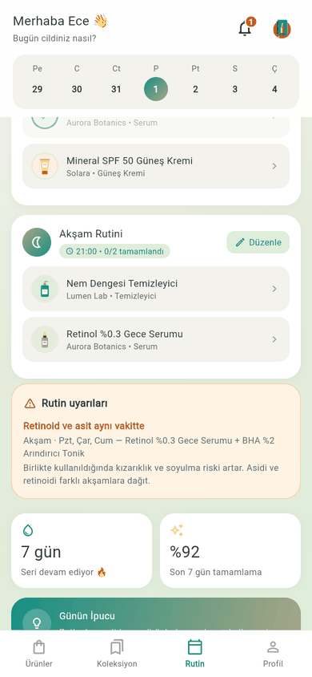
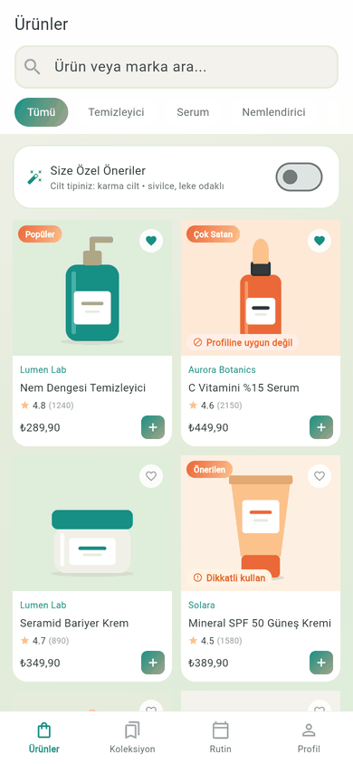
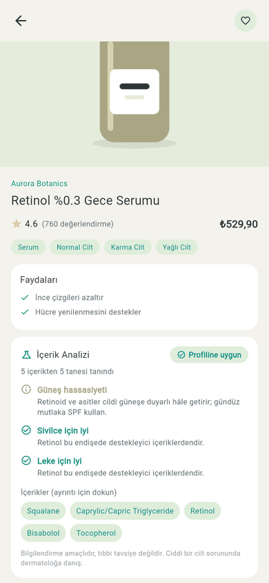
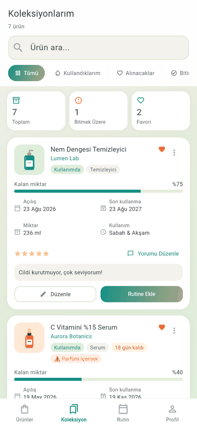

# SkinSavvy

[](https://github.com/melisayalcinkaya/SkinSavvy/actions/workflows/ci.yml)
[](https://melisayalcinkaya.github.io/SkinSavvy/)


[](LICENSE)

**Kişisel cilt bakım asistanı.** Ürünlerinin içerik listesini cilt profiline göre
yorumlar, aynı akşam kullanılmaması gereken ürünleri rutininde yakalar, açılan
ürünlerin bozulma tarihini hatırlatır. Ürün satmaz: katalog, kullanıcıların eklediği
ve ekibin onayladığı ürünlerden oluşan **topluluk veritabanıdır**; bilgiyi kullanıcı
yorumları tamamlar.

Cilt bakımında sorun genelde ürünün kendisi değil, birlikte nasıl kullanıldığıdır:
retinol ile peeling tonik aynı akşam sürülür, hassas cilde parfümlü serum alınır,
altı ay önce açılmış C vitamini serumu hâlâ kullanılır. SkinSavvy bu üç hatayı
kullanıcı fark etmeden önce gösterir.

**▶ Canlı demo:** https://melisayalcinkaya.github.io/SkinSavvy/ → "Demo hesabıyla dene"
(kayıt gerekmez; demo verisi tarayıcında kalır).

<p>
  
  
  
  
</p>

## Özellikler

- **Cilt profili:** 5 adımlı karşılama: cilt tipi, endişeler (akne, leke, gözenek…),
  kaçınılacak maddeler (listeden ya da elle) ve rutin yoğunluğu.
- **İçerik analizi:** INCI listesi 65 içerik grubundan (150 INCI adı + 10 kalıp)
  oluşan bir bilgi tabanında eşleştirilir (`Aqua`, `Parfum (Fragrance)`, `Cocos Nucifera (Coconut) Oil`, `*paraben` gibi
  yazım farklarıyla). Profile göre:
  - kaçınılacak madde varsa **"Profiline uygun değil"**,
  - hassas ciltte parfüm, kuru ciltte listenin başındaki alkol, akneye eğilimli
    ciltte gözenek tıkayıcı (komedojen) içerik, güçlü aktifler için **uyarı**,
  - endişelere iyi gelen içerikler (ör. sivilce için niacinamide, çinko) için **olumlu not**.

  Ürün kartlarında rozet, ürün detayında tam analiz, ürün eklerken yazdıkça canlı
  analiz, "Size özel öneriler" filtresinde uyum puanına göre sıralama.
- **Rutin çakışma uyarıları:** sabah/akşam rutini haftanın günleriyle planlanır.
  Retinoid + AHA/BHA, retinoid + benzoil peroksit, iki peeling ürünü aynı vakitte
  ve **ortak günlerde** kullanılırsa uyarır (Pzt/Çar/Cum BHA + her akşam retinol →
  yalnızca Pzt, Çar, Cum). Sabah retinoidi, asit varken sabah SPF eksikliği ve
  akşam güneş kremi de raporlanır.
- **Bozulma ve azalma hatırlatmaları:** son kullanma tarihi ile "açıldıktan sonra
  X ay" (PAO) süresinden hangisi önce dolarsa o esas alınır. Süresi dolan,
  yaklaşan (gün sayısı ayarlanabilir), azalan ürünler ve saati geçmiş rutinler
  zil simgesinde rozetle görünür.
- **Ürün dolabı:** kullanılanlar, alınacaklar, bitenler; kalan miktar, puan, not,
  "tekrar alır mıyım", bitenleri **memnun kaldıklarım / kalmadıklarım** diye süzme
  ve paylaşma. Profilde eklediğim, kullandığım ürün ve yorum sayıları.
- **Topluluk ürün veritabanı:** Ücretli ve kapsamlı bir kozmetik API'si olmadığı
  için ürünleri kullanıcılar ekler (zorunlu fotoğraf, içerik listesi, barkod, cilt
  tipleri). Öneri, ekip karar verene kadar yalnızca ekleyene görünür; aynı ad/marka
  ya da barkod ikinci kez eklenemez. **Reddetme yoktur**: kullanıcıya "düzelt, yeniden
  gönder" yükü bindirilmez. Ekip, uygulama içindeki **onay kuyruğunda** fotoğrafı,
  bilgileri, kaç içeriğin tanındığını ve katalogdaki benzer ürünleri görüp şu
  kararlardan birini verir:

  | Karar | Ne olur |
  |---|---|
  | **Onayla** / **Düzenle ve onayla** | Eksik ya da hatalı bilgiyi (ad, marka, kategori, cilt tipi, içerik, barkod, fotoğraf) ekip düzeltir; ürün herkese açılır, ekleyenin dolabındaki kayıt da güncellenir. |
  | **Yinelenen** | Ürün katalogda zaten var: öneri asıl ürüne bağlanır, ekleyenin dolap kaydı tarihleri, notu ve yorumuyla birlikte asıl ürüne taşınır. |
  | **Sil** (spam/sahte) | Öneri katalogdan ve ekleyenin dolabından kalkar; fotoğrafı ve içeriği saklanmaz. |

  Her kararda ekleyene zil simgesinden bildirim gider. Ürün sayfasında
  "Ekleyen: Zeynep K." yazar, yeni onaylananlar "Yeni" etiketi alır.
- **Yorumlar:** ürün başına tek yorum (ikincisi günceller). Puanlar yalnızca gerçek
  yorumlardan hesaplanır; yorumu olmayan ürün "Henüz değerlendirme yok" der. Fiyat,
  "çok satan" gibi mağaza ögeleri yok.
- **İki çalışma modu:** varsayılan **cihaz modu** her şeyi tarayıcıda/telefonda
  tutar (demo böyle çalışır). `API_URL` verilirse **sunucu modu**: hesap, profil,
  katalog, öneriler ve yorumlar FastAPI sunucusundan gelir.

## Mimari

```
app/ (Flutter: Android, iOS, web)
  lib/presentation/   25+ ekran, ortak bileşenler (analiz kartı, uyarı kartı…)
  lib/state/          ChangeNotifier denetleyicileri (provider), kullanıcıya özel
  lib/domain/         saf Dart iş kuralları: içerik analizi, rutin danışmanı,
                      hatırlatmalar (Flutter'a bağımlı değil, birim testli)
  lib/data/           modeller, LocalStore (SharedPreferences / localStorage),
                      AuthRepository → LocalAuthRepository | RemoteAuthRepository,
                      ApiClient
backend/ (FastAPI + SQLAlchemy 2; SQLite ya da PostgreSQL)
  app/routers/        auth, me, products (+ yorumlar), admin
  app/data/           demo kataloğu: uygulamayla AYNI JSON (testle denetlenir)
```

Ekranlar verinin nerede durduğunu bilmez: `AuthRepository` arayüzünün cihaz ve
sunucu uygulamaları var, katalog ve yorum denetleyicileri `ApiClient` verilirse
sunucuya gider. Dolap, rutin ve tamamlama kaydı iki modda da cihazda kalır
(kişisel kullanım verisi; senkronizasyon ileride).

## Güvenlik

**Sunucu**
- Şifreler **argon2** ile; kurallar Türkçe mesajlı (en az 8 karakter, harf + rakam,
  e-posta/ad içermez).
- 15 dakikalık JWT erişim token'ı + **dönen refresh token** (veritabanında yalnızca
  SHA-256 özeti). İptal edilmiş bir refresh token tekrar gelirse (çalınmış olabilir)
  o girişten türeyen **bütün oturum ailesi** kapatılır; diğer cihazlar etkilenmez.
- Bilinmeyen e-posta ve yanlış şifre **aynı mesaj ve benzer sürede** yanıtlanır
  (sahte argon2 doğrulaması) → hesap varlığı sızmaz.
- Hız sınırı: girişte IP ve hesap başına, kayıtta IP başına, öneri ve yorumda
  kullanıcı başına. `X-Forwarded-For` yalnızca ters vekil arkasında güvenilir.
- Başkasının bekleyen önerisi **404** döner (varlığı da sızmaz); "ekip düzenledi" ve
  "yinelenen" bilgisi yalnızca sahibine. Ekip kararları yalnızca yönetici rolüyle;
  düzeltilen bilgi de öneriyle aynı doğrulamadan (görsel imzası, yinelenen kontrolü)
  geçer. Yorumlarda e-posta yok, ad "Ayşe Y." biçiminde.
- Görseller uzantıya değil **dosya imzasına** göre (gerçekten PNG/JPEG mi) ve boyuta
  göre doğrulanır; SVG ve uzak adres kabul edilmez. Metinlerde kontrol karakterleri
  ve `<`/`>` temizlenir; bilinmeyen alanlar 422.
- JSON için `Content-Security-Policy: default-src 'none'`, `nosniff`, `DENY`,
  üretimde HSTS; CORS yalnızca listedeki kökenler. `SECRET_KEY` üretimde zorunlu
  (≥ 32 karakter); Docker imajı root olmayan kullanıcıyla çalışır.

**Uygulama**
- Cihaz modunda şifre PBKDF2-HMAC-SHA256 + hesap başına tuz, sabit zamanlı karşılaştırma.
- Erişim token'ı yalnızca bellekte; aynı anda 401 alan istekler **tek** yenileme yapar.
- Her kullanıcının verisi ayrı anahtar önekinde; hesap silinince hepsi temizlenir.

## Kurulum

### Uygulama (cihaz modu)

```bash
cd app
flutter pub get
flutter run -d chrome          # ya da bir Android/iOS cihazı
```

### Sunucu

```bash
cd backend
python -m venv .venv && source .venv/bin/activate   # Windows: .venv\Scripts\activate
pip install -r requirements-dev.txt
cp .env.example .env            # ADMIN_EMAIL / ADMIN_PASSWORD verirsen yönetici oluşur
uvicorn app.main:app --reload   # http://localhost:8000/docs
```

Açılışta demo kataloğu ve demo hesabı yüklenir: `demo@skinsavvy.app` / `demo-sifre-2026`.
Docker ile: `docker build -t skinsavvy-api backend && docker run -p 8000:8000 -e SECRET_KEY=... skinsavvy-api`.
Render'a kurmak için depodaki `render.yaml` (New → Blueprint) yeterli.

### Uygulamayı sunucuya bağlamak

```bash
cd app
flutter run -d chrome --web-port 8080 --dart-define=API_URL=http://localhost:8000
```

Yönetici hesabıyla girildiğinde profilde **Onay Bekleyen Ürünler** görünür (API'de
`/admin/submissions`). Cihaz modundaki demo hesabı, akışın tamamı denenebilsin diye
ekip yetkisiyle açılır; sunucudaki demo hesabı ise sıradan kullanıcıdır.

### Demo kataloğu

Katalog `app/lib/data/demo/demo_catalog.dart` içinde. Değiştirdikten sonra sunucunun
kopyasını güncelle:

```bash
cd app && dart run tool/export_demo_catalog.dart
```

## Testler

| | Kapsam |
|---|---|
| **Uygulama** (`flutter test`) | içerik eşleştirme ve analiz kuralları, rutin danışmanı, hatırlatmalar (PAO / SKT, ay sonu taşması), ekip kararlarının dolaba ve yorumlara yansıması, kalıcılık ve kullanıcı ayrımı, kimlik doğrulama, sahte sunucuyla sunucu modu (token yenileme, çevrimdışı yorum kuyruğu, yarış durumu), demo / kayıt / karşılama / öneri-onay-yinelenen-silme akışları, **320 px, 390 px ve 1280 px'te bütün ana ekranlarda taşma taraması** |
| **Sunucu** (`pytest`) | kayıt/giriş, token dönüşü ve aile iptali, hız sınırları, yetki ve görünürlük, görsel doğrulama, onay / düzeltip onay / yinelenen / silme kararları, yorumlardan hesaplanan puan, hesap silme, güvenlik başlıkları, Docker duman testi; uygulamadaki seçenek listeleriyle **sözleşme testi** · kapsam ~%99 (CI alt sınırı %90) |

CI her gönderimde: `dart format`, `flutter analyze`, testler, web derlemesi; `ruff`,
`pytest --cov`, Docker imajı + duman testi; ikisi de geçerse GitHub Pages'e yayın.

## Bilinen sınırlamalar

- İçerik analizi **bilgilendirme amaçlıdır**, tıbbi değerlendirme değildir. Bilgi
  tabanı yaygın 65 içerik grubuyla sınırlı; tanınmayan maddeler "tanınmadı" sayılır.
  Komedojen puanları saf madde testlerine dayanır, ürünün tamamını birebir yansıtmaz.
- Hatırlatmalar **uygulama içinde**; telefon bildirimi (push) henüz yok.
- Dolap ve rutin cihazda tutulur; sunucu modunda cihazlar arası eşitleme yok.
- Şifre sıfırlama e-postası yok (bu yüzden "Şifre Değiştir" satırı gizli).
- Hız sınırlayıcı bellekte; birden çok sunucu süreci için Redis gerekir.
- Render ücretsiz planında sunucu 15 dk hareketsizlikte uyur (ilk istek ~1 dk) ve
  SQLite dosyası her dağıtımda sıfırlanır; kalıcı veri için PostgreSQL bağlanmalı.
- Fotoğraftan cilt analizi bilerek yapılmadı: tıbbi iddia riski ve farklı ten
  renklerinde güvenilmez sonuç.

## Yol haritası: yapay zekâ ile moderasyon

Topluluk veritabanı büyüdükçe onay kuyruğunu tek tek incelemek zorlaşır. Kararı yine
ekip verecek şekilde, ekibe öneri sunan adımlar planlanıyor:

- **İçerik doğrulama:** fotoğraftaki ambalajdan içerik listesini (OCR) okuyup
  kullanıcının yazdığıyla karşılaştırmak; eksik ya da hatalı maddeleri işaretlemek.
- **Fotoğraf kalite kontrolü:** bulanık, karanlık ya da ürün olmayan fotoğrafları
  gönderimden önce kullanıcıya bildirmek.
- **Yinelenen tespitini otomatikleştirmek:** bugünkü ad/marka/barkod benzerliğinin
  yerine görsel ve metin benzerliğiyle olası asıl ürünü güven puanıyla önermek.
- **Kişisel öneriler:** cilt profili, dolap geçmişi ve "memnun kaldıklarım"
  listesinden yola çıkarak benzer içerikli ürünler önermek (tıbbi iddia olmadan).

## Proje geçmişi

Arayüz tasarımı ve ilk Flutter ekranları (25'ten fazla ekran, sabit verili prototip) Temmuz
2026'da Melisa Yalçınkaya tarafından yapıldı; depodaki ilk commit bu hâlidir. Sonraki
commit'lerde veri katmanı, kalıcı kayıt, içerik analizi, rutin uyarıları,
hatırlatmalar, FastAPI sunucusu, testler ve CI eklendi.

## English summary

SkinSavvy is a Flutter skincare assistant (Android, iOS, web) with an optional
FastAPI backend. It analyses a product's INCI list against the user's skin profile
(allergens, fragrance on sensitive skin, drying alcohol, comedogenic ingredients,
helpful actives), flags routine conflicts such as a retinoid and an acid on the same
evening (only on the weekdays they overlap), and reminds users when an opened
product passes its period-after-opening or printed expiry date. It sells nothing: the
catalog is a community database built from user submissions (a photo is required).
There is no "reject": in an in-app review queue the team approves a submission
(optionally fixing its details first), links it to the existing product as a
duplicate (the submitter's shelf entry, dates and review move with it), or deletes
spam; the submitter is notified either way. Ratings come only from real reviews.
The roadmap adds AI assistance for the review queue (OCR ingredient checks, photo
quality checks, duplicate detection) and personal recommendations. The backend
provides accounts with argon2 and rotating refresh tokens (reuse detection revokes
the login family), the moderated catalog and reviews. The app runs
fully on-device by default (the GitHub Pages demo) or against the API with
`--dart-define=API_URL=...`. CI runs format, analysis, Flutter and pytest suites, a
layout overflow scan at 320/390/1280 px, a Docker smoke test, and deploys the web build.

## Lisans

[MIT](LICENSE) © 2026 Melisa Yalçınkaya
